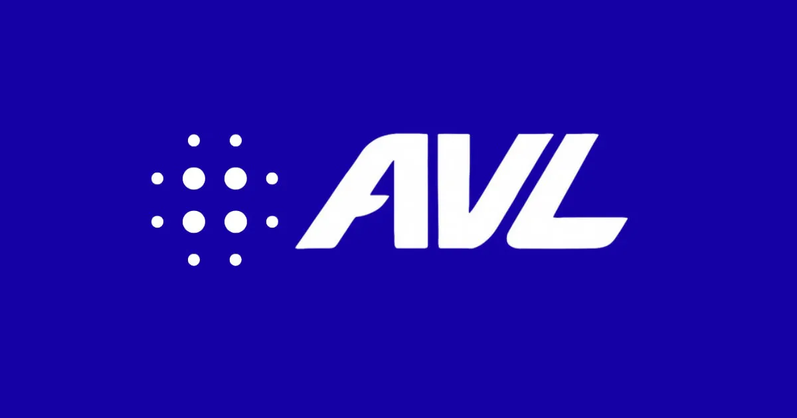
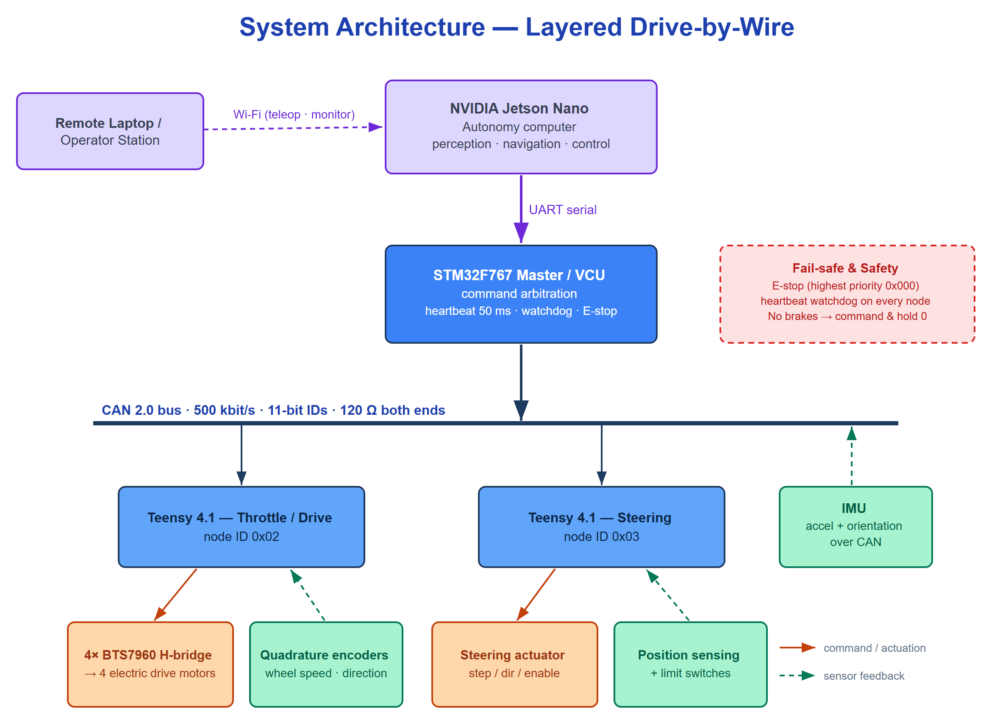

<div align="center">



# AVL_CARL

**A**utonomous **V**ehicle **L**ab — **C**ontrol **A**rchitecture for **R**obotic **L**ocomotion

*A wireless, modular drive-by-wire electric go-kart platform for autonomous ground-vehicle research.*


</div>

---

## Overview

**AVL_CARL** is a distributed, drive-by-wire electric go-kart built by the Autonomous
Vehicle Lab at **California State Polytechnic University, Pomona** as a platform for
autonomous ground-vehicle research. It uses a **layered embedded architecture**: a
high-level autonomy computer plans and commands, while a real-time embedded network
actuates and reports feedback.

| Layer | Runs on | Responsibility |
|-------|---------|----------------|
| **Autonomy / teleop** | NVIDIA **Jetson Nano** (ROS 2) | Perception, navigation, control, teleop mixing, telemetry |
| **Vehicle control (VCU)** | STM32 **NUCLEO-F767ZI** | Serial↔CAN proxy, heartbeat, e-stop, teleop watchdog |
| **Actuation / sensing** | 2× **Teensy 4.1** | Motor drive + encoders (throttle), steering |

The Jetson connects to the master over a **framed binary UART** link; the master
translates commands onto a **classic CAN 2.0** backbone to the Teensy nodes. Because the
master is a thin proxy, all vehicle-level logic lives in the [ROS 2 workspace](ros2_ws/),
keeping the safety-critical firmware small and deterministic.

> ⚠️ **Safety note — no mechanical brakes.** This vehicle has **no brake actuator**.
> It decelerates by commanding **zero throttle and holding zero** to the traction motors.
> Always operate in a controlled environment with a hardware kill switch / power cutoff
> within reach. See [Safety](#safety).

---

## System Architecture



```
  Remote laptop ──Wi-Fi──▶ Jetson Nano ──UART (framed binary)──▶ STM32 Master / VCU
   (teleop, monitor)        ROS 2 autonomy                        (proxy + safety)
                                                                        │
       ══════════════════════ CAN 2.0 bus · 500 kbit/s · 120 Ω both ends ═══════════════
                │                               │                          │
       ┌────────┴────────┐            ┌─────────┴────────┐        (IMU, telemetry
       │ THROTTLE / DRIVE│            │     STEERING     │         over CAN)
       │   Teensy 4.1    │            │    Teensy 4.1    │
       │ 4× BTS7960 +    │            │  step/dir/enable │
       │ wheel encoders  │            │  + limit switches│
       └─────────────────┘            └──────────────────┘
```

### Design principles

- **Layered separation.** High-level autonomy (Jetson/ROS 2) is decoupled from
  safety-critical, real-time actuation (firmware).
- **One subsystem per node.** Each microcontroller owns one safety-relevant function.
- **Command/feedback over CAN.** No analog control wiring between subsystems.
- **Fail-safe by default.** Loss of the master heartbeat, an e-stop frame, or a stalled
  ROS 2 stack (teleop watchdog) all drive the vehicle to a safe state (motors → 0,
  steering → hold) — consistent with the no-brake stop strategy.

Full rationale: [`docs/architecture.md`](docs/architecture.md).

---

## Node / Microcontroller Assignment

Inventory: **2× Teensy 4.1** and **1× STM32 NUCLEO-F767ZI** — one board per node, **no spare**.

| Node | Board | Why this board |
|------|-------|----------------|
| **Master / VCU** | **NUCLEO-F767ZI** | On-board ST-LINK VCP for the Jetson serial link; Cortex-M7 + FPU headroom; bxCAN. |
| **Throttle / Motor-drive** | **Teensy 4.1** | Most I/O-heavy node: hardware quadrature decoders + abundant FlexPWM for 4 motor drivers; 600 MHz real-time; FlexCAN. |
| **Steering** | **Teensy 4.1** | Lowest-complexity node: CL57T `step/dir/enable` + limit switches; same Teensyduino toolchain as throttle. |

---

## Hardware

Full bill of materials, part numbers, ratings, and pinouts: [`docs/hardware.md`](docs/hardware.md).

| Subsystem | Key parts |
|-----------|-----------|
| **Propulsion** | 4× **MY4845** 24 V 150 W geared motors, each driven by an **IBT_2 (BTS7960)** H-bridge |
| **Sensing (drive)** | **E38S6-600-24G** quadrature encoders (600 PPR, 5–24 V → level-shifted to 3.3 V) |
| **Steering** | Stepper via **CL57T** closed-loop driver (`step/dir/enable`, 24 V), Ackermann geometry, limit switches |
| **Motion feedback** | **IMU** (acceleration + orientation) for localization / stability |
| **Compute** | 2× Teensy 4.1 + 1× NUCLEO-F767ZI · Jetson Nano companion |
| **CAN** | Adafruit **TJA1051T/3** ×3 transceivers (3.3 V, switchable 120 Ω) |
| **Power** | 24 V propulsion + actuator rail |

---

## Communication — CAN Bus

- **Standard:** Classic **CAN 2.0** (Teensy FlexCAN + STM32 bxCAN — no CAN-FD on this hardware).
- **Bitrate:** 500 kbit/s. **Topology:** single linear bus, **120 Ω at both physical ends**.
- **IDs:** 11-bit, lower = higher priority. E-stop (`0x000`) and heartbeat (`0x010`) get top priority.
- The full node-ID allocation and message map is maintained in [`docs/can-bus.md`](docs/can-bus.md).

The Jetson↔master serial framing (SOF + length + CRC8) is defined in
[`firmware/lib/carl_protocol/wire.h`](firmware/lib/carl_protocol/wire.h) and mirrored in
the ROS 2 bridge at [`ros2_ws/src/carl_bridge/carl_bridge/protocol.py`](ros2_ws/src/carl_bridge/carl_bridge/protocol.py).

---

## Safety

- 🛑 **No brakes.** Deceleration is "command 0 and hold." Always operate near a hardware kill switch.
- 💓 **Heartbeat + watchdog.** Edge nodes fail to a safe state (motors → 0, steering → hold) on loss of the master heartbeat.
- ⏱️ **Teleop watchdog.** If the ROS 2 stack stops sending commands, the master forces throttle to zero.
- 🧯 **E-stop.** Highest-priority CAN frame (`0x000`) latches every node into the safe state.
- 🧪 **Bench first.** Validate each node on the bench (wheels off the ground) before integrated tests.

---

## Repository Structure

```
AVL_CARL/
├── README.md            ← you are here (team-facing overview)
├── docs/                ← hardware, architecture, CAN map, wiring, roadmap, assets
├── firmware/            ← PlatformIO monorepo (master / throttle / steering + shared lib)
└── ros2_ws/             ← ROS 2 workspace (Jetson autonomy + serial↔CAN bridge)
    └── src/carl_bridge/ ← serial ↔ ROS 2 bridge (scaffold)
```

> `CLAUDE.md` and `.claude/` are local-only Claude Code files and are git-ignored.
> Presentation/poster build artifacts (`*.pptx`, `docs/render/`) are also kept out of the repo.

---

## Getting Started

### Firmware (PlatformIO)

```bash
cd firmware
pio run -e throttle              # build ONLY the throttle node
pio run -e master                # build ONLY the master (NUCLEO)
pio run                          # build all nodes
pio run -e throttle -t upload    # flash a connected Teensy throttle node
pio test -e native               # run protocol unit tests on the PC (no hardware)
```

| Node | Board | PlatformIO env / platform |
|------|-------|---------------------------|
| master | NUCLEO-F767ZI | `master` · `ststm32` |
| throttle | Teensy 4.1 | `throttle` · `teensy` |
| steering | Teensy 4.1 | `steering` · `teensy` |

### ROS 2 companion (laptop or Jetson)

```bash
cd ros2_ws
colcon build --symlink-install
source install/setup.bash
ros2 run carl_bridge bridge_node
```

See [`ros2_ws/README.md`](ros2_ws/README.md). Teleoperation and vehicle-level control run
as ROS 2 nodes on the companion and reach the vehicle over the serial↔CAN bridge.

---

## Documentation

| Document | Contents |
|----------|----------|
| [`docs/hardware.md`](docs/hardware.md) | Bill of materials, part numbers, ratings, wiring, electrical integration |
| [`docs/architecture.md`](docs/architecture.md) | Node topology, MCU-to-node rationale, capability comparison, caveats |
| [`docs/can-bus.md`](docs/can-bus.md) | CAN bitrate, node IDs, message/ID allocation map |
| [`docs/wiring.md`](docs/wiring.md) | Pin-level wiring per node |
| [`docs/roadmap.md`](docs/roadmap.md) | Phased plan, milestones, open questions |
| [`docs/field-test-2026-10-25.md`](docs/field-test-2026-10-25.md) | Outdoor test 1, phone connection recovery, velocity assessment, validation and rollout |

---

## Team

**California State Polytechnic University, Pomona — Autonomous Vehicle Lab (Summer Cohort)**
Faculty Mentor: Behnam Bahr · Team Leads: Caleb Hylkema, Garret Anderson

---

## Contributing

When adding hardware or changing the architecture, **update the relevant `docs/` file in
the same change** so documentation stays in lockstep with the vehicle. Node firmware lives
under `firmware/<node>/`; ROS 2 packages under `ros2_ws/src/`.
