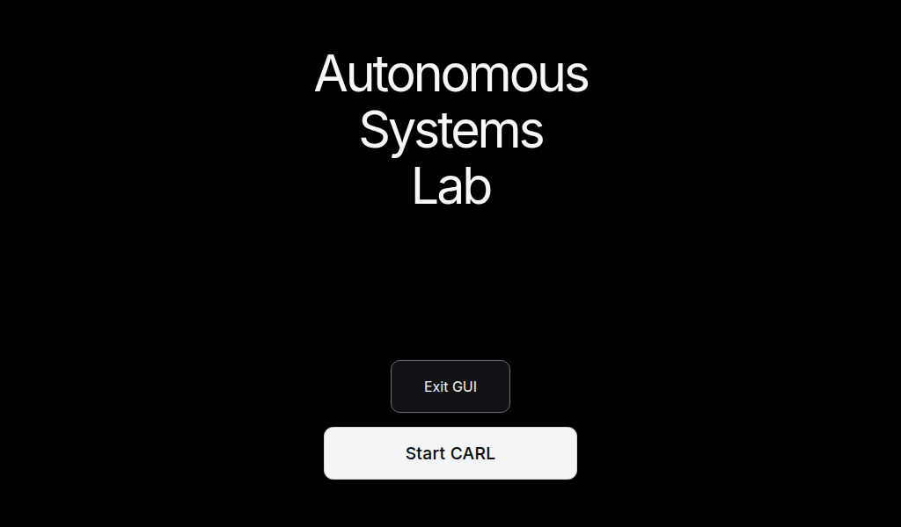
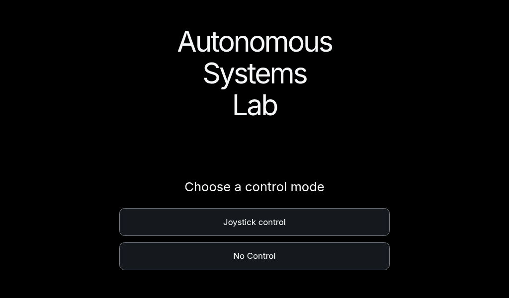
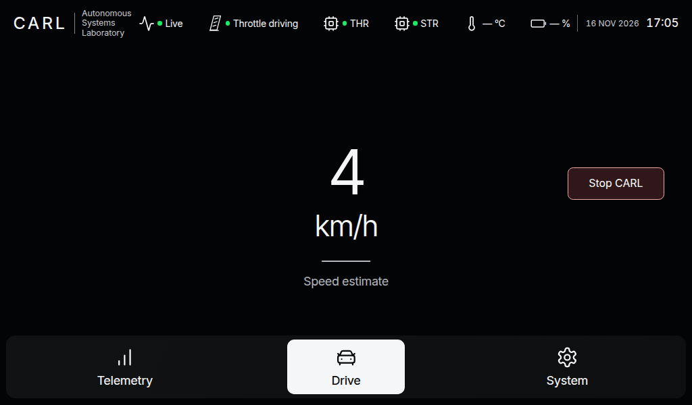
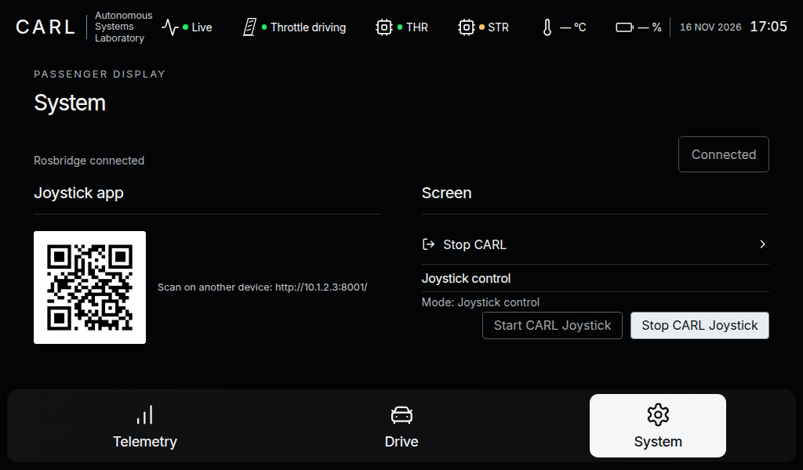
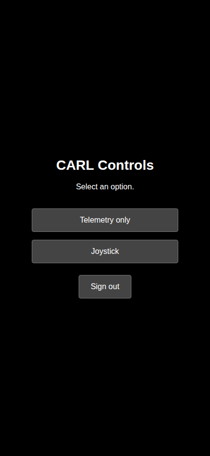
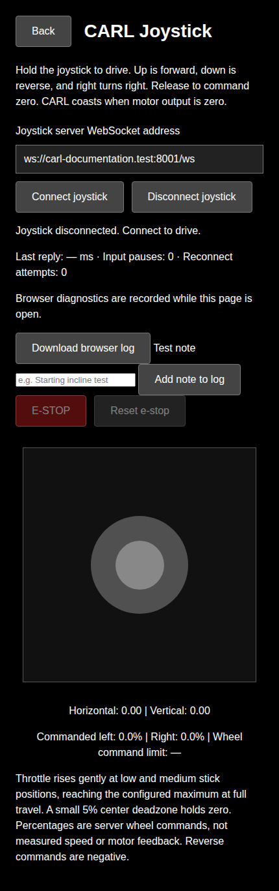

# CAR 1 (CARL): project handover and operating guide

**Snapshot date: November 23, 2026.** This guide describes the local CARL projects available on that date. It is intended for a new team member, including someone who has not used electronics, Linux, or ROS before.

The project owner's hardware and progress statements supplied for this handover establish the current physical status. Local source code establishes software behavior. Older project READMEs sometimes describe planned hardware as installed, call the future computer a Jetson Nano, or describe the master as only a proxy. Where those descriptions conflict, this guide uses the owner's current status and the implemented code. This is a source review, not a new vehicle inspection or driving test.

## Contents

1. [CAR 1 introduction](#1-car-1-introduction)
2. [Current hardware architecture](#2-current-hardware-architecture)
3. [Current software architecture](#3-current-software-architecture)
4. [How to use CARL](#4-how-to-use-carl)
   - [4.1 Organize the host computer and repositories](#41-organize-the-host-computer-and-repositories)
   - [4.2 Install dependencies and prepare the software](#42-install-dependencies-and-prepare-the-software)
   - [4.3 Start CARL manually in terminals](#43-start-carl-manually-in-terminals)
   - [4.4 Start CARL through the local GUI and connect a joystick](#44-start-carl-through-the-local-gui-and-connect-a-joystick)
   - [4.5 Stop, diagnose, and recover](#45-stop-diagnose-and-recover)
5. [Future CARL projects](#5-future-carl-projects)
6. [Source index and handover gaps](#6-source-index-and-handover-gaps)

## 1. CAR 1 introduction

CARL is the Autonomous Vehicle Lab's electric go-kart research platform at California State Polytechnic University, Pomona. The main repository expands CARL as **Control Architecture for Robotic Locomotion**. This guide uses **CAR 1** for the vehicle project and **CARL** for the platform and its control system.

The long-term aim is a vehicle on which the team can develop autonomous driving: sensing the surroundings, locating the vehicle, planning movement, and controlling it. The current milestone is **drive-by-wire**. This means electrical commands control the motors instead of an operator directly applying a mechanical throttle. CARL can now receive joystick commands through ROS 2 and drive its four wheels.

Current turning uses **differential drive**, also called skid steering: the wheels on one side are commanded differently from those on the other side. This is separate from the planned steering and suspension work. The steering controller reads an absolute encoder, but its steering motor is disabled in the current firmware.

| Area | Current position |
| --- | --- |
| Drive-by-wire | Achieved: joystick commands travel through ROS 2 to the embedded motor controllers. |
| Traction | Four independently driven 24 V motors; all-wheel drive. Rear encoders supply feedback. |
| Host computer | ASUS Zephyrus G15 GA503QR temporarily runs the host software. |
| Intended onboard computer | NVIDIA Jetson Orin Nano Super; not currently available/installed, per the project owner. |
| Operator software | Browser joystick, separate browser telemetry, local passenger GUI, and terminal teleoperation exist. |
| Mechanical work | Front/rear suspension and Ackermann steering changes, floor, seat, and upper frame construction/installation remain. |
| Tuning | More precise speed and steering tuning must follow the mechanical changes. |
| Autonomy | Not an operating capability of the current startup stack. Required mounts, compute, and a suitable sensor set remain outstanding. |

Ackermann steering lets the inside and outside front wheels follow different turning angles. Completing that mechanism will require corresponding control work; reading the steering encoder today does not mean CARL already performs motorized Ackermann steering.

Future sensing should cover the front, rear, left, and right sides and include suitable cameras, GPS, and LiDAR. The team currently has one RealSense camera for camera-based emergency-stop development. It does not constitute the intended autonomy sensor suite.

**Understand the stopping behavior before operating:** the current platform has no mechanical brake actuator. Zero motor output makes CARL **coast**. A software E-stop latches zero output; it does not guarantee an immediate physical stop or disconnect battery power. Locate the physical E-stop and the main power cutoff with the project owner before the first powered session. Their location and complete wiring are not established by the available files.

## 2. Current hardware architecture

### 2.1 Power distribution

The project owner describes the present power path as follows. A **bus bar** is a common power connection point. A **buck converter** lowers a DC voltage.

```text
24 V system battery (25.6 V nominal)
    |
    +-- positive lead --> inline 50 A fuse / manual switch --> +24 V bus bar
    +-- negative lead -------------------------------------> GND bus bar

Bus bars supply:
    +-- 24 V fuse box --> 4 motor drivers --> 4 traction motors
    +-- 24-to-12 V converter --> intended Jetson Orin Nano Super supply
    |                           (Jetson not installed)
    +-- 24-to-5 V converter --> Teensy units, motor-driver logic,
                                wheel/steering encoders
                                  |
                                  +-- MCU 3.3 V outputs --> 3.3 V electronics
```

GND is the shared electrical reference. The 24 V, 5 V, and 3.3 V control circuits need the documented common ground connections. A 5 V power supply does **not** mean every connected signal may be 5 V: Teensy inputs are limited to 3.3 V.

The battery-monitor concept identifies the pack as an Ingeosolly `INGO-24V50`, LiFePO4, nominally 25.6 V, 50 Ah, and 1280 Wh, based on owner identification. Exact manufacturer charging limits and transient ratings remain unconfirmed. The present handover does not establish converter current ratings, all branch fuse values, cable gauges, or the laptop's power arrangement. The 12 V branch describes the intended Jetson provision; it does not prove the laptop is powered by it.

### 2.2 Controllers, actuators, and sensors

| Item | Quantity / identity | What it does now |
| --- | --- | --- |
| Host computer | ASUS Zephyrus G15 GA503QR | Runs ROS 2, application servers, and the local browser display. |
| Master / vehicle control unit | One STM32 NUCLEO-F767ZI | Connects host serial to CAN; handles heartbeat, E-stop, command timeout, IMU acquisition, and relative heading correction. |
| Throttle controller | One Teensy 4.1 | Drives four motor modules, reads two rear encoders, balances rear wheel RPM, and enforces local timeouts. |
| Steering controller | One Teensy 4.1 | Reads the absolute steering encoder and sends telemetry; steering actuator stays disabled. |
| Traction motors | Four MY4845, documented as 24 V / 150 W geared DC motors | One motor per wheel. |
| Traction drivers | Four IBT_2 modules using BTS7960 devices | Convert PWM and direction signals into motor power. |
| Wheel encoders | Two E38S6-600-24G rear quadrature encoders | Report incremental wheel movement. |
| Steering encoder | Identified as P3022-V0; exact variant not authoritatively confirmed | Firmware expects an analog 0–5 V, full-turn output, reduced before reaching the Teensy. |
| Steering actuator hardware | CL57T closed-loop stepper driver; motor model not recorded | Retained hardware; disabled in the current software phase. |
| IMU | Installed replacement identified in captures as MPU-9250; MPU-6500 also supported | Acceleration, angular velocity, die temperature, and master-local relative heading input. |
| CAN interface | Three Adafruit TJA1051T/3 transceiver breakouts | Connect the three microcontrollers to the vehicle communication bus. |
| Camera | One RealSense camera; AEB source targets a D455 | Separate emergency-stop research; not automatically started by normal bringup. |

A **microcontroller** runs a small firmware program directly on an embedded board. The laptop is different: it runs Linux and multiple applications. An **encoder** measures rotation. An **IMU** measures motion; its temperature reading is the sensor chip temperature, not ambient air.

### 2.3 Communication and key signal connections

```text
Laptop -- USB / ST-LINK virtual serial --> NUCLEO master
                                               |
                                 classic CAN 2.0, 500 kbit/s
                                  /                         \
                        throttle Teensy               steering Teensy
                         |          |                       |
                    four drivers  rear encoders       absolute encoder
                         |
                    four motors
```

The host serial link uses **921600 baud** in the ROS configuration. PlatformIO's `monitor_speed = 115200` is not the bridge's runtime baud setting. Serial data is framed binary, not human-readable terminal text.

CAN is the shared message bus between embedded boards. It uses a twisted CANH/CANL pair plus the documented ground reference. There must be exactly two 120 Ω terminators, one at each physical cable end. The wiring reference places the master in the middle with termination off, and throttle and steering at the ends with termination on. Confirm this against the actual harness before modifying it.

Important current pin assignments, checked against the firmware and wiring reference:

| Signal | Connection |
| --- | --- |
| Throttle and steering CAN1 | Teensy TX 22, RX 23, each through its transceiver |
| Master CAN1 | PD1 TX, PD0 RX |
| Master host link | ST-LINK USB virtual COM port, USART3 PD8/PD9 |
| Front-left motor | Throttle Teensy RPWM 2, LPWM 3, enable 10 |
| Front-right motor | RPWM 4, LPWM 5, enable 11 |
| Rear-left motor | RPWM 8, LPWM 9, enable 24 |
| Rear-right motor | RPWM 6, LPWM 7, enable 12 |
| Rear-left encoder A/B | Throttle Teensy 16/17 through level shifting |
| Rear-right encoder A/B | Throttle Teensy 14/15 through level shifting |
| Absolute steering encoder | Steering Teensy 14/A0 through a 10 kΩ / 10 kΩ divider |
| Master MPU SPI4 | MOSI PE6, MISO PE5, clock PE2, chip select PE4 |

Pin numbers on the two Teensys refer to different physical boards. Do not interchange their connections. Right-side motor direction is already inverted in firmware, so positive commands mean vehicle-forward on all wheels. Do not add another inversion in the joystick application.

Motor PWM is 20 kHz with 12-bit resolution. Each driver's two enable inputs are tied to its listed enable GPIO. The driver's current-sense outputs are not wired in this phase, so the present system has no measured per-motor current limiting.

Rear encoders are supplied at 5 V and use a BSS138 level-shifter board before the Teensy inputs. The steering encoder uses a resistor divider: encoder OUT → 10 kΩ → ADC junction → 10 kΩ → ground. The junction goes to A0. Confirm the actual sensor variant and measure the reduced voltage before connecting it. See [wiring](wiring.md) and [steering encoder setup](steering-encoder.md) for the full connection and calibration procedures. These tables are a reference for an existing harness, not a substitute for checking an undocumented wire with power disconnected.

## 3. Current software architecture

### 3.1 ROS 2 and the two data paths

The inspected laptop runs **Ubuntu 26.04.1 LTS** with **ROS 2 Lyrical** installed at `/opt/ros/lyrical`. ROS 2 provides communication between programs. A **node** is a running ROS program; a **topic** is a named stream of messages; a **message type** defines the fields carried by that stream.

The driving path is:

```text
Phone/browser joystick
  --> joystick WebSocket on host port 8001 (/ws)
  --> carl_joystick ROS node
  --> /carl/throttle_cmd and /carl/estop
  --> carl_bridge --> framed serial --> STM32 master
  --> CAN --> throttle Teensy --> PWM/enables --> motor drivers --> wheels
```

Keyboard or USB-gamepad teleoperation can replace the first two steps. Only one driving source should run at a time. There is no general ROS command arbitration that prevents competing publishers from sending conflicting throttle messages.

The feedback path runs in the opposite direction:

```text
Encoders / motor-controller status --> CAN --> master --> serial --> carl_bridge
Master IMU --------------------------------------------------------> carl_bridge
  --> ROS topics --> rosbridge WebSocket on port 9090
  --> local passenger GUI and controls application's Telemetry only page
```

`carl_bridge` and `rosbridge_server` are different programs. The first communicates with CARL hardware; the second exposes ROS messages to web browsers. A connected browser socket does not prove that the vehicle is connected or ready.

### 3.2 ROS workspace and firmware responsibilities

| Component | Location | Responsibility |
| --- | --- | --- |
| `carl_msgs` | `AVL_CARL/ros2_ws/src/carl_msgs` | Custom throttle, status, encoder, heartbeat, E-stop, steering, and velocity message definitions. Build these before dependent packages. |
| `carl_bridge` | `AVL_CARL/ros2_ws/src/carl_bridge` | Serial transport, frame validation/decoding, command encoding, ROS telemetry, and provisional velocity estimation. |
| `carl_bringup` | `AVL_CARL/ros2_ws/src/carl_bringup` | Top-level launch includes the bridge launch, which starts `bridge_node` and `velocity_node` in this snapshot. |
| `carl_teleop` | `AVL_CARL/ros2_ws/src/carl_teleop` | Keyboard and ROS gamepad command publishers. Separate from browser joystick control. |
| `carl_joystick` | `CARL_Joystick/src/carl_joystick` | FastAPI/Uvicorn HTTP/WebSocket server and ROS command integration. |
| Embedded firmware | `AVL_CARL/firmware` | Master, throttle, steering, shared protocol, and hardware I/O. Built with PlatformIO, not colcon. |

**colcon** builds ROS workspaces. **PlatformIO** builds and uploads embedded firmware. **npm** installs/builds the local web GUI. Building one does not build the others.

The master is more than a serial proxy: it acquires the MPU IMU and can add bounded left/right throttle corrections during eligible straight commands. It first requires stationary calibration using gyro, encoder, and idle throttle evidence. Allow at least three seconds stationary at neutral plus another 500 ms of valid heading samples. Turning, reversing direction, and neutral release the captured heading reference. This is relative straight-line assistance, not navigation or a compass. Full engagement limits are in the [firmware guide](../firmware/README.md#mpu-relative-heading-hold).

The throttle Teensy balances rear wheel RPM from the encoders. That adjustment means commanded percentages and actual rear PWM can differ. It is not a calibrated vehicle speed controller or an electrical current limiter. The front wheels have no encoder feedback in this implementation.

The steering Teensy samples A0 at 50 Hz using a 12-bit ADC and 16-reading hardware averaging. The bridge defaults to `steering.calibrated: false`; a centered steering angle is unavailable until the mounting offset, direction, and ratio are established. The encoder does not currently control steering or heading hold.

### 3.3 Messages, timing, and stop behavior

| ROS topic | Type | Meaning |
| --- | --- | --- |
| `/carl/throttle_cmd` | `carl_msgs/msg/CarlThrottleCmd` | Four signed normalized wheel requests; +1 forward, −1 reverse, 0 neutral. |
| `/carl/estop` | `carl_msgs/msg/CarlEstop` | Operator stop reason 1; reset reason 0. |
| `/carl/heartbeat` | `carl_msgs/msg/CarlHeartbeat` | Master counter, state flags, and operating mode. |
| `/carl/throttle_status` | `carl_msgs/msg/CarlThrottleStatus` | Throttle state, faults, applied left/right output. |
| `/carl/encoders` | `carl_msgs/msg/CarlEncoderFeedback` | Raw rear wheel counts. |
| `/carl/steering_angle` | `carl_msgs/msg/CarlSteeringAngle` | ADC, voltage, absolute/centered angle, validity, calibration, status. |
| `/carl/velocity` | `carl_msgs/msg/CarlVelocity` | Provisional signed rear-wheel velocity in m/s and validity. |
| `/carl/imu` | `sensor_msgs/msg/Imu` | Raw acceleration including gravity and angular velocity in sensor axes; installed MPU path has no fused orientation. |
| `/carl/imu/temperature` | `sensor_msgs/msg/Temperature` | IMU chip temperature in °C. |
| `/carl/imu/diagnostics` | `std_msgs/msg/String` | JSON containing sensor identity, stage, readiness, and errors. |

The velocity estimator uses a 0.2-second window, 43.5 inches of travel per wheel revolution, and measured counts of 11998.0 left / 12001.6 right per wheel revolution. Encoder shaft PPR and wheel-revolution counts are different quantities. The rolling distance still needs validation under normal ground load. Displayed speed is provisional and does not enforce a speed limit.

The common protocol defines these CAN messages:

| CAN ID | Purpose | Normal interval |
| --- | --- | --- |
| `0x000` | E-stop | Event |
| `0x010` | Master heartbeat | 50 ms |
| `0x100` | Four-wheel throttle command | 20 ms |
| `0x110` | Reserved/currently unused steering command | Defined 20 ms |
| `0x200` | Throttle status | 50 ms |
| `0x210` | Rear encoder counts | 20 ms |
| `0x220` | Steering safe-idle status | 50 ms |
| `0x221` | Steering encoder feedback | 20 ms |

Serial uses start-of-frame, length, and CRC8 error checking. Protocol definitions in `firmware/lib/carl_protocol/wire.h` and the bridge's `protocol.py` must agree. MPU `0x230`–`0x232` telemetry, SPI diagnostics `0x23b`, and heading status `0x239` are host wire messages; do not assume every serial message ID is an active CAN frame. The bridge does not currently publish `0x239` heading status as a ROS topic.

Independent timeout layers reduce the chance of retaining a stale drive command:

| Layer | Implemented behavior |
| --- | --- |
| Browser | At 200 ms without a command reply, cancels held input; after three seconds, reconnects at neutral. |
| Joystick server | 250 ms input timeout, checked every 50 ms; also stops on lost readiness, disconnect, or invalid input. |
| Master | Zeroes retained drive commands after 300 ms without host command refresh. |
| Throttle Teensy | Disables motor output after 150 ms without valid heartbeat or throttle commands. |
| Software E-stop | Latches safe output until an explicit reset. Reset clears retained input; it must not resume a previous held command. |

These are software thresholds, not physical stopping-distance guarantees. Zero output coasts.

### 3.4 Local GUI and joystick application integration

The **local GUI** (`CARL_Graphical_User_Interface`) is a Next.js/React passenger display designed for a 1024 × 600 touchscreen. It reads ROS telemetry through rosbridge and provides Drive, Telemetry, and System screens. It does not publish driving commands through its ROS transport.

Its startup buttons instead call a local Next.js API, which talks over a Unix socket to `carl-operation.service`. That Python supervisor sources ROS/workspace environments, starts the hardware bridge and rosbridge, and optionally starts the joystick server. It checks heartbeat and throttle feedback as well as process status. It stops its managed processes on failures or missed display check-ins. `carl-passenger-gui.service` separately owns the GUI server and kiosk browser.

The current control API only accepts `127.0.0.1:3215`, with the matching browser origin for actions. A plain GUI server on port 3000 is therefore not an equivalent operating procedure, even though the GUI README retains a generic port-3000 example. The current home screen requires the supervisor startup flow; legacy dashboard URLs redirect there. There is no documented attach-only passenger dashboard route for manually owned ROS processes.

The **controls application** (`CARL_Controls_Application`) is a separate set of HTML/CSS/JavaScript pages. The joystick server can serve it directly on port 8001. Its Telemetry only page subscribes through rosbridge; its Joystick page uses only the joystick server and does not subscribe to vehicle telemetry. Sign-in is a browser admission screen, not server-side security for an untrusted network.

The **joystick server** (`CARL_Joystick`) accepts one browser controller. It requires healthy heartbeat and throttle status received within one second, sends commands at 20 Hz, applies a 5% dead zone and a quadratic throttle curve, and mixes forward/turn requests into wheel commands. Default straight wheel-command maximum is 75%; pure-turn limit is 40%. Those are command limits, not measured speed, current limits, or a guarantee that rear regulation stays below that PWM percentage.

The server's protocol v2 requires fresh, single-use reply tokens for drive/reset requests. Release, interruptions, lost readiness, and reconnect require neutral and fresh input. Updating the joystick server should be paired with reloading the browser scripts.

The local GUI System screen generates a controls-app QR code from the host network address. A phone disconnect makes the supervisor send zero, stop its joystick process, and return to No Control. Starting the server does not itself grant a browser control. No Control disables the managed joystick process; it cannot block an unrelated ROS publisher.

`AVL_GUI_Server` currently contains a README describing a future shared registry/authentication/telemetry server. It has no runnable server implementation in this checkout and is not needed for current CARL operation.

The RealSense AEB project contains detection and watchdog code that publish `/carl/estop`, plus a demo. Normal bringup and the GUI supervisor do not launch it. Camera detection requests the existing zero-output stop; the project name does not imply a mechanical brake. Its `SLOW` classification does not by itself establish implemented speed reduction. Its package/layout issues are listed in section 6.

## 4. How to use CARL

Read section 4.1 and complete the one-time preparation in 4.2 first. Then choose **manual startup (4.3)** or **GUI-managed startup (4.4)** for a session. The two methods must not own the same hardware bridge at the same time.

Commands below use Bash on the current Ubuntu laptop. A terminal is a window in which you type commands; open one with the desktop Terminal application or Ctrl+Alt+T. Copy the command text, not the surrounding Markdown fences. Press Enter after each command. A command that reports an error has not completed successfully; resolve it before continuing.

`~` means your home folder. `cd` changes folders. `sudo` authorizes a system administration command and may ask for your login password; the password is not displayed while typing. `source` loads settings into the current terminal only. Leave a running server terminal open; Ctrl+C stops that process.

Before any powered motion check, support CARL securely with all driven wheels clear, clear loose items and people from moving parts, and have the physical cutoff accessible. A new operator should have a team member identify and demonstrate the actual cutoff and power sequence first: the available files do not establish a complete physical switch-by-switch sequence. Do not improvise wiring from software instructions.

### 4.1 Organize the host computer and repositories

Keep the repositories as siblings in one parent folder. This is required by the current GUI supervisor's path discovery, not just a preference. For a new account, this guide uses `~/Documents/AVL`. The inspected account already uses `/home/izakulus/Documents/AVL`.

```text
~/Documents/AVL/
├── AVL_CARL/
│   ├── firmware/
│   ├── ros2_ws/src/
│   └── docs/CARL_HANDOVER.md
├── CARL_Joystick/src/carl_joystick/
├── CARL_Controls_Application/src/
├── CARL_Graphical_User_Interface/
├── CARL_Emergency_Braking_System/       # separate research
├── AVL_GUI_Server/                    # concept README
├── CARL_PCB_Design/                    # battery-monitor design work
├── CARL_3D_prints/                     # local mechanical design files
└── Documentation/                     # local proposal material
```

If these folders already exist, use them; do not clone another copy over them. For a new checkout, after installing Git in 4.2:

```bash
mkdir -p "$HOME/Documents/AVL"
cd "$HOME/Documents/AVL"
git clone https://github.com/calebhylkema/AVL_CARL.git
git clone https://github.com/IzAKuLuS/CARL_Joystick.git
git clone https://github.com/IzAKuLuS/CARL_Controls_Application.git
git clone https://github.com/IzAKuLuS/CARL_Graphical_User_Interface.git
```

Optional related-project clones:

```bash
cd "$HOME/Documents/AVL"
git clone https://github.com/IzAKuLuS/CARL_Emergency_Braking_System.git
git clone https://github.com/IzAKuLuS/AVL_GUI_Server.git
git clone https://github.com/IzAKuLuS/CARL_PCB_Design.git
```

No Git remote was established for `CARL_3D_prints` or `Documentation`; obtain the existing folders from the project handover if needed.

**Preserve the local snapshot before moving to another computer.** There are uncommitted and untracked implementation changes, notably velocity telemetry and the joystick curve. A fresh clone at the revisions in section 6 does not reproduce all behavior described here. Arrange a reviewed commit or complete working-tree transfer, including new source/message files, before expecting a new host to match. Do not overwrite existing local changes with a reset or checkout.

### 4.2 Install dependencies and prepare the software

#### A. Host operating system and ROS prerequisite

These instructions target the inspected Ubuntu 26.04.1 laptop and ROS 2 Lyrical. They are not a verified Jetson deployment recipe. The future Jetson's operating system, power integration, and dependency compatibility still need separate validation.

If `/opt/ros/lyrical/setup.bash` already exists, continue below. A new host first needs Ubuntu's package sources and the ROS 2 apt repository configured, then the Lyrical installation. The project repositories do not contain a complete clean-OS/bootstrap procedure. Use the [official ROS 2 Lyrical Ubuntu installation guide](https://docs.ros.org/en/lyrical/Installation/Ubuntu-Install-Debs.html) for that system step. That page could not be retrieved during this handover review, so no unverified repository/key setup commands are copied here. This is an explicit remaining clean-host setup dependency.

With the ROS package repository configured, install the runtime and development dependencies below. Package names were checked against the current host's package metadata and project manifests; this command was not executed as part of writing the guide.

```bash
sudo apt update
sudo apt install git build-essential cmake python3-pip python3-venv \
  python3-colcon-common-extensions python3-rosdep \
  python3-serial python3-fastapi python3-uvicorn python3-websockets \
  ros-lyrical-ros-base ros-lyrical-rosbridge-server ros-lyrical-joy \
  ros-lyrical-rosbag2 nodejs npm x11-xserver-utils x11-utils
```

`ros-base` supplies the ROS foundation; rosbridge supplies browser telemetry; `joy` supports a USB gamepad; rosbag2 supports optional ROS recordings. FastAPI, Uvicorn, and websockets run the browser joystick server; pyserial connects the bridge to the NUCLEO. X11 utilities support touchscreen placement and kiosk management. Node.js must be **22.9 or newer** for the GUI's documented setup. The inspected host has Node 22.22.1.

```bash
source /opt/ros/lyrical/setup.bash
printenv ROS_DISTRO
node --version
npm --version
```

Expect `lyrical` and a suitable Node version. Install Chromium for the Linux passenger launcher if it is absent. The current host uses Ubuntu's Chromium Snap at `/snap/bin/chromium`:

```bash
sudo snap install chromium
```

Run that only if Chromium is missing. The desktop launcher needs a working graphical **X11** session, systemd user services, and one active **1024 × 600 landscape** touchscreen. Use the desktop display settings to configure that display; the launcher will reject an absent or ambiguous matching display. The current laptop's documented output is `HDMI-1`, but another computer's connector name may differ.

#### B. Resolve ROS package dependencies and build in order

After cloning, initialize rosdep only if it has not already been initialized on this computer:

```bash
sudo rosdep init
```

If it reports an existing configuration, do not delete it. Continue with:

```bash
rosdep update
source /opt/ros/lyrical/setup.bash
cd "$HOME/Documents/AVL/AVL_CARL/ros2_ws"
rosdep install --from-paths src --ignore-src --rosdistro lyrical -y
colcon build --symlink-install
source install/setup.bash
ros2 interface show carl_msgs/msg/CarlThrottleCmd
ros2 interface show carl_msgs/msg/CarlVelocity
```

The build command is `colcon build --symlink-install`. It has no extra `e`. This builds the messages and all core packages in dependency order. `--symlink-install` links suitable source files into the install area for development; message definitions, setup files, and compiled changes still need a rebuild.

Now build the joystick workspace with the core overlay already loaded:

```bash
cd "$HOME/Documents/AVL/CARL_Joystick"
rosdep install --from-paths src --ignore-src --rosdistro lyrical -y
colcon build --symlink-install
source install/setup.bash
ros2 pkg prefix carl_joystick
```

Do not run colcon from the common `AVL` parent: the experimental AEB repository includes a conflicting `carl_msgs` manifest. The two supported ROS build roots are `AVL_CARL/ros2_ws` and `CARL_Joystick`. Existing `AVL_CARL/build` and `AVL_CARL/install` folders are from a different root-level build pattern; this guide consistently uses `AVL_CARL/ros2_ws/install`.

#### C. Prepare the local GUI and desktop integration

```bash
cd "$HOME/Documents/AVL/CARL_Graphical_User_Interface"
npm ci
npm run build
python3 scripts/install-passenger-launcher.py
```

`npm ci` installs versions from `package-lock.json`; `npm run build` prepares the production web application. The installer must run as the desktop user, **without sudo**. It creates the CARL Passenger GUI desktop shortcut and both user services. Re-run it if the repository moves or the Python location changes.

The GUI defaults to local rosbridge. A nonlocal `NEXT_PUBLIC_ROSBRIDGE_URL` must be set before building, as described in its README. Do not build the deployment with test-fixture URLs or `CARL_GUI_TEST_BUILD` enabled.

The controls application is static HTML/JavaScript and has no separate npm build requirement. The joystick server serves its `src` folder. Docker and `AVL_GUI_Server` are not required.

#### D. Check USB access and communication settings

Connect the NUCLEO using its **ST-LINK USB connection**, which provides the host serial device. Check:

```bash
ls -l /dev/ttyACM*
ls -l /dev/serial/by-id/
groups
```

The current bridge configuration expects `/dev/ttyACM0` at 921600 baud. Identify which listed device belongs to the NUCLEO; numbering can change. If its group is `dialout` and your user lacks membership:

```bash
sudo usermod -aG dialout "$USER"
```

Log out of the desktop and log back in for the new membership to apply. Do not run the GUI or all ROS processes as root to work around access errors.

The serial settings are in `AVL_CARL/ros2_ws/src/carl_bridge/config/bridge.yaml`. The GUI supervisor also currently hard-codes `/dev/ttyACM0` in `scripts/carl-supervisor.py`. If the device path changes, both must agree; rebuild the core workspace and restart the affected software afterward. A stable by-ID path can only be used after identifying the actual board and updating both locations.

All ROS terminals and services must use the same ROS distribution, domain, and middleware/discovery settings. No custom domain ID is established by this guide. If this installation uses custom `ROS_DOMAIN_ID`, `RMW_IMPLEMENTATION`, or discovery settings, ensure the user services receive the same settings as the terminals; do not assume shell-only exports reach a service.

#### E. Build/upload firmware when needed

Firmware is the program stored on each embedded board. **Normal daily startup does not require reflashing it.** Only upload when deploying a reviewed firmware change or preparing a replacement board.

Install PlatformIO into its own Python environment if `pio` is absent:

```bash
python3 -m venv "$HOME/.venvs/carl-platformio"
"$HOME/.venvs/carl-platformio/bin/python" -m pip install platformio
source "$HOME/.venvs/carl-platformio/bin/activate"
cd "$HOME/Documents/AVL/AVL_CARL/firmware"
pio run -e master -e throttle -e steering
```

PlatformIO downloads the configured STM32/Teensy platforms and libraries on first build. The manifest uses Arduino, `STM32_CAN` for the master, and `Encoder` plus the Teensy core's `FlexCAN_T4` for throttle. It selects the MPU SPI implementation for the normal master build. Some platform/library versions are not pinned, so retain the known working toolchain when reproducing the snapshot.

With propulsion isolated, stop every program using the NUCLEO serial device. Identify the board before uploading. Connect only the intended Teensy when uploading a Teensy target, since throttle and steering use the same board type:

```bash
pio run -e master -t upload
pio run -e throttle -t upload
pio run -e steering -t upload
```

Run the relevant line after connecting/identifying that board; these are three different targets, not three firmware images for one board. The NUCLEO uses ST-LINK/SWD. Teensy uses its upload loader and may require its program button. If USB upload access fails, resolve the toolchain's ST-LINK/Teensy udev/loader requirements before retrying. Exact fresh-host programmer-rule installation is not recorded in the project.

#### F. Separate research dependencies

RealSense AEB code imports `cv2` (OpenCV), `numpy`, `pyrealsense2`, and ROS `rclpy`, `std_msgs`, and `carl_msgs`. These are additional to the normal driving stack. A verified RealSense SDK/Python installation procedure for this Ubuntu/Python combination and a working package installation layout are not supplied by the repository. Do not treat a successful normal CARL startup as proof that camera E-stop is running. Section 6 records the packaging gap; this guide does not invent an AEB installation command.

PCB and 3D-design files are design artifacts, not dependencies of daily vehicle operation. Their exact editor versions and manufacturing readiness are not established here.

### 4.3 Start CARL manually in terminals

This method makes each running process visible. Start with the vehicle stationary, controls released, and the physical safety setup checked. Confirm no GUI-managed CARL session or other hardware bridge is running. If switching from the GUI, press **Stop CARL** and **Close local GUI** first.

Every new ROS terminal starts with this common block:

```bash
source /opt/ros/lyrical/setup.bash
source "$HOME/Documents/AVL/AVL_CARL/ros2_ws/install/setup.bash"
```

Keep each process in its own terminal. Choose only one of the Terminal 3 control alternatives below.

#### Terminal 1 — hardware bridge and velocity estimator

```bash
source /opt/ros/lyrical/setup.bash
source "$HOME/Documents/AVL/AVL_CARL/ros2_ws/install/setup.bash"
ros2 launch carl_bringup carl.launch.py
```

This starts the core serial bridge and velocity node. It does not start rosbridge, a joystick, or the local GUI. `ros2 launch carl_bridge bridge.launch.py` is an alternative to this command, not an additional process to run beside it.

#### Terminal 2 — browser telemetry bridge

```bash
source /opt/ros/lyrical/setup.bash
source "$HOME/Documents/AVL/AVL_CARL/ros2_ws/install/setup.bash"
ros2 launch rosbridge_server rosbridge_websocket_launch.xml
```

Source the CARL overlay here too: rosbridge needs the custom `carl_msgs` definitions. Its default WebSocket port is 9090.

#### Terminal 3A — browser/phone joystick, recommended for the touch application

```bash
source /opt/ros/lyrical/setup.bash
source "$HOME/Documents/AVL/AVL_CARL/ros2_ws/install/setup.bash"
source "$HOME/Documents/AVL/CARL_Joystick/install/setup.bash"
ros2 launch carl_joystick joystick.launch.py \
  controls_dir:="$HOME/Documents/AVL/CARL_Controls_Application/src"
```

This serves the controls application at `http://HOST-IP:8001` and accepts joystick connections at `ws://HOST-IP:8001/ws`. Replace `HOST-IP` with the laptop's reachable network address. On the laptop itself, `http://localhost:8001` works. Follow the browser steps in 4.4, starting with phone/network connection. Do not also start 3B or 3C.

#### Terminal 3B — keyboard alternative

```bash
source /opt/ros/lyrical/setup.bash
source "$HOME/Documents/AVL/AVL_CARL/ros2_ws/install/setup.bash"
ros2 run carl_teleop keyboard_teleop
```

Click inside this terminal so it receives key presses. It starts in DRIVE mode at the 25% setting. Press `n` for neutral while preparing. `g` returns to DRIVE; hold `w`/`s` for forward/reverse and `a`/`d` for left/right turning. Space releases held commands; `x` latches E-stop; `r` requests reset at zero; `q` quits. The first key press can remain active for up to the 0.55-second initial-repeat grace period; after continuous key repeat, the release timeout is 0.10 seconds.

Keys `1`/`2`/`3`/`4` select 25/50/75/100% settings. **The browser's 75% maximum does not apply to this node.** Given the reported driver damage at high throttle, do not use high settings as an initial test. Turning and simultaneous inputs also affect wheel requests. Stop this node before changing control sources.

#### Terminal 3C — physical USB gamepad alternative

```bash
source /opt/ros/lyrical/setup.bash
source "$HOME/Documents/AVL/AVL_CARL/ros2_ws/install/setup.bash"
ros2 launch carl_teleop teleop.launch.py
```

This launches ROS `joy_node` and `joy_teleop`. Default indices are throttle axis 1, steering axis 3, deadman button 4, and E-stop button 1; throttle/turn parameters are each 0.4. Button numbers are ROS array indices, not universal labels on a controller. Confirm its mapping with propulsion disabled using `ros2 topic echo /joy` in another sourced terminal. The deadman button must be held to drive. Combined-axis mixing can exceed either individual 0.4 parameter; neither is a global per-wheel cap. The gamepad implementation does not expose an E-stop reset button. Do not start another teleop publisher merely to reset it; first stop the gamepad node and follow the team's controlled reset procedure.

#### Terminal 4 — optional separate telemetry web server

With browser joystick 3A, the controls pages are already served on 8001. Open **Telemetry only** from that application's menu in another browser tab/device if desired. If using keyboard/gamepad, or serving the pages separately:

```bash
cd "$HOME/Documents/AVL/CARL_Controls_Application"
python3 -m http.server 8000 --bind 0.0.0.0 --directory src
```

Open `http://HOST-IP:8000`, sign in, and choose **Telemetry only**. Its telemetry address should be `ws://HOST-IP:9090`. This static server does not start joystick control.

#### Local passenger GUI alongside manual commands — current limitation

The present local GUI is tied to the supervisor described in 3.4. Do not launch it and press Start CARL while the manual bridge/rosbridge are running: the supervisor cannot adopt those processes and may report busy resources. Use the controls application's telemetry page for the complete manual workflow, then stop the manual processes before switching to 4.4 for the local touchscreen experience.

For a terminal-launched **GUI-managed** session, after installing its services, with the manual stack stopped:

```bash
cd "$HOME/Documents/AVL/CARL_Graphical_User_Interface"
npm start -- --hostname 127.0.0.1 --port 3215
```

Open `http://127.0.0.1:3215` on the laptop and follow 4.4. This starts the GUI server from a terminal, but its buttons still ask the supervisor to own CARL's ROS processes. Do not run it while `carl-passenger-gui.service` already owns port 3215. For the automatic kiosk/touchscreen placement, use the desktop launcher instead.

#### Terminal 5 — inspect readiness without commanding movement

```bash
source /opt/ros/lyrical/setup.bash
source "$HOME/Documents/AVL/AVL_CARL/ros2_ws/install/setup.bash"
ros2 node list
ros2 topic list -t
ros2 topic echo /carl/heartbeat --once
ros2 topic echo /carl/throttle_status --once
```

Expect fresh heartbeat and a throttle state consistent with idle/zero output before testing movement. A healthy heartbeat alone does not prove both Teensys work. For continued observation, omit `--once` and stop the display with Ctrl+C. Check individual streams in turn:

```bash
ros2 topic hz /carl/encoders
ros2 topic hz /carl/imu
ros2 topic echo /carl/imu/diagnostics --full-length
```

Use Ctrl+C between these commands. Nominal rear encoder feedback is 50 Hz and healthy MPU output is approximately 100 Hz. Do not expect speed validity until the estimator has enough fresh samples. Do not expect a calibrated steering angle or fused MPU orientation with current defaults.

### 4.4 Start CARL through the local GUI and connect a joystick

#### A. Open and start the passenger GUI

1. Complete 4.2, including the production build and launcher installer. Confirm the touchscreen is active at 1024 × 600 landscape. Stop manually launched bridge, rosbridge, and joystick processes.
2. Connect the laptop's NUCLEO USB link and prepare vehicle power using the team-demonstrated physical sequence. Keep controls untouched and the vehicle stationary.
3. Double-click **CARL Passenger GUI** on the desktop. If the desktop asks whether to allow launching the installed shortcut, allow that shortcut. The launcher opens Chromium in kiosk mode on the matching display and serves the GUI at `127.0.0.1:3215`.
4. Press **Start CARL**. After the title transition, the supervisor starts/checks the hardware bridge and then rosbridge. If it shows an error, resolve that error instead of repeatedly starting duplicate processes.
5. Choose **Joystick control** to start/check the joystick server, or **No Control** for monitoring. Read the physical E-stop reminder before the Drive screen appears.
6. Leave CARL stationary and neutral for IMU calibration before straight-line tests. Confirm healthy fresh throttle feedback and zero output. Do not clear an E-stop until the vehicle is safe and its cause is understood.



*Welcome screen. This existing repository test capture shows the Start CARL entry point.*



*Control selection after hardware/telemetry startup. These GUI captures were generated with simulated test services/data, not during this handover's vehicle operation.*



*Drive screen. Example numbers are test values, not measurements of CARL's current condition.*

#### B. Connect a phone or another browser device

1. Put the phone and host on a network where the phone can reach the host. Neither remote joystick nor telemetry needs public internet access during operation; initial software installation does.
2. Open the GUI's **System** screen. Scan its controls-app QR code. If there is no usable QR code, check the host's network connection. You can inspect host addresses with `hostname -I`; if several are shown, identify the address belonging to the shared network rather than guessing.
3. Alternatively, enter `http://HOST-IP:8001` in the phone browser. `HOST-IP` means the laptop address. `localhost` on the phone means the phone itself and will not reach CARL.
4. Sign in with a team-provided configured eight-digit passcode. Do not guess repeatedly: five failed attempts cause a four-minute lockout and further failures increase the wait. This guide does not reproduce operational passcodes.
5. Choose **Joystick**. Check that the WebSocket address is `ws://HOST-IP:8001/ws`, then press **Connect joystick**. Wait for readiness with the stick released. The server admits one controller at a time.
6. For a first test, use a small forward input with wheels lifted. Release and confirm commanded output returns to zero and the local GUI shows the applied output returning to zero. Repeat cautiously for reverse/turning. Only proceed to a controlled ground test after checks pass.



*Existing simulated-service System capture showing joystick management and the controls link. Its QR/address is an example; use the live display's current link.*



*Current controls application captured on November 23, 2026 using synthetic documentation-only admission, with vehicle connections disabled.*



*Current joystick page, shown disconnected. The page was rendered from the local source; no vehicle connection or driving command was made to obtain this image.*

#### C. Use the joystick and read the display

Touch and hold the stick: up requests forward, down reverse, and right a right turn. Release to command zero. Begin with small movements. The response is deliberately gentle near the center because the server squares the rescaled throttle input. At full straight travel the default request reaches 75%; this is not a recommended endurance test for the existing drivers.

The displayed left/right percentages are **commands**, not measured speed or current. Applied motor output is separately reported by the vehicle. With no current sensors wired, the software cannot prove a driver is below a chosen amperage.

**E-STOP** latches software stop and **Reset e-stop** requests clearing it at zero output. Both require a working joystick connection. Always use the physical E-stop/cutoff for unexpected motion or uncertain state. Releasing the stick is a coast command, not an active brake.

Changing apps, hiding the page, losing focus/capture, interrupted touches, rotation, or resizing can cancel held input. Let go and make a fresh touch after readiness returns. Reconnection does not restore a previous held drive command. In a GUI-managed session, a phone disconnect also stops the managed joystick server and returns the GUI to No Control; select **Start CARL Joystick** in System before accepting another controller. For a manually launched joystick server, that additional supervisor behavior does not apply.

Use **Telemetry only** in a separate tab/device to inspect browser telemetry, or the local GUI's **Telemetry** screen. A tab switch cancels joystick input. Do not expect telemetry panels on the Joystick page itself.

The GUI's THR and STR indicators describe recent controller feedback, not a complete hardware self-test. Steering can report healthy raw data while its centered angle is uncalibrated. Missing/stale measurements should become unavailable rather than remain trusted. Battery percentage and ambient temperature are unavailable until corresponding sensors and software exist. IMU die temperature is a different measurement.

### 4.5 Stop, diagnose, and recover

For a normal **manual** shutdown, release input and verify zero commanded/applied output. Disconnect/quit the selected controller, then Ctrl+C the joystick/teleop process, rosbridge, and finally bringup. Stop any static web server. Once motion has ceased and the team procedure permits it, switch off vehicle power. Do not disconnect/rework live wiring.

For a normal **GUI-managed** shutdown, release the joystick, then press **Stop CARL** on Drive or System. The supervisor stops control first, then bridge and rosbridge, while leaving the GUI available for another startup. **Close local GUI** under System stops CARL software and closes the kiosk. The welcome screen's **Exit GUI** closes the display/service; the supervisor stops CARL after missing display check-ins. Prefer the explicit stop/close flow over relying on a timeout. None of these buttons removes battery power.

| Symptom | Check / recovery |
| --- | --- |
| `ros2: command not found` | Source `/opt/ros/lyrical/setup.bash` in that terminal. Confirm ROS is installed. |
| CARL package or message missing | Build and source `AVL_CARL/ros2_ws/install/setup.bash`; build/source joystick afterward if needed. Confirm the local snapshot includes new message files. |
| Serial device missing or access denied | Confirm NUCLEO ST-LINK cable, actual device path, power, and user permissions. |
| Serial busy or port already in use | Stop the other manual/managed session. Run only one hardware bridge and one server per port. |
| GUI error on port 3000 or hostname `localhost` | Current control API requires `http://127.0.0.1:3215`. Use the installed launcher or the exact 3215 terminal command. |
| Launcher cannot find display | Check active resolution, landscape orientation, X11 session, and display layout. It does not reconfigure other monitors automatically. |
| WebSocket connected but telemetry empty | Confirm fresh ROS topics, sourced custom messages in rosbridge, matching domain/discovery settings, and actual STM32 feedback. |
| Joystick not ready | Check fresh heartbeat and throttle status, faults, E-stop state, and whether another controller owns the session. Release input before retrying. |
| Phone cannot open page | Use host LAN IP, confirm server is running, and check port reachability/network isolation/firewall. 8001 serves controls, 9090 carries telemetry. |
| Phone disconnected and GUI shows No Control | Start joystick again from System, then reconnect at neutral. |
| One motor fails | See [joystick troubleshooting](joystick-troubleshooting.md); isolate wiring/driver/motor with propulsion made safe. A vehicle E-stop normally disables all four channels. |
| Steering angle unavailable | Check raw encoder feedback, wiring variant/divider, and calibration. The motor remains disabled by design. |
| IMU diagnostics show an old error count | Check current readiness/error and fresh samples; a historical count alone does not prove a present fault. |
| Battery/ambient reading missing | Expected until the relevant sensor pipeline exists. Do not fill with guessed values. |

Useful GUI logs and status commands:

```bash
systemctl --user status carl-passenger-gui.service carl-operation.service
journalctl --user -u carl-passenger-gui.service -n 100 --no-pager
journalctl --user -u carl-operation.service -n 100 --no-pager
```

The supervisor writes child logs under `${XDG_STATE_HOME:-$HOME/.local/state}/carl-operation/`, including `bridge.log`, `rosbridge.log`, and `joystick.log`. The joystick's diagnostic runs default to `~/.ros/carl_test_runs`. Its browser page has **Download browser log** for connection/input timing evidence. See the [joystick README](../../CARL_Joystick/README.md) for retention, optional ROS bags, and offline analysis.

If the GUI has failed, use the physical cutoff whenever state is uncertain. Once physically safe, these commands stop its managed services:

```bash
systemctl --user stop carl-passenger-gui.service carl-operation.service
```

They do not stop unrelated manually launched processes or disconnect power. Investigate the fault before restarting.

## 5. Future CARL projects

### 5.1 Mechanical work and the transition to autonomy

The immediate vehicle work is front/rear suspension and Ackermann steering changes, followed by more precise speed/steering tuning, and the floor, seat, upper frame, and associated chassis additions. These changes affect sensor mounting, wheel geometry, loading, and control calibration.

The project owner identifies three present obstacles to serious autonomy development: no suitable finished mounting structure for the planned sensors, no available Jetson Orin Nano Super for the intended onboard compute/remote-control deployment, and an incomplete sensor inventory. The single RealSense camera is allocated to camera-based E-stop development. Existing AEB experiments do not mean the full autonomy effort has begun or that its hardware requirements are met.

The intended sequence is to complete those mechanical additions and obtain/integrate the required compute and sensors, then begin the autonomy side in earnest. No particular autonomy package, camera layout, GPS model, LiDAR model, or completed sensor interface is established by the current projects.

### 5.2 Custom motor-driver PCB project

This is a potential project while suspension and structural work proceeds. The aim is more reliable traction hardware that can sustain the required load without the failures reported at approximately 75–100% throttle.

The owner's proposed goals are sustained current capability of at least 10 A, a configurable current clamp such as 10 A, and circuit protections against high-throttle damage. Those are design targets, not measured capabilities or finalized requirements. A command percentage cannot establish current: loading, acceleration, and a stalled motor can change it substantially.

The available PCB repository contains battery-monitor files; no current motor-driver schematic, finalized protection design, or validated prototype was found. Future work must establish whether the current target is per motor/module, the required continuous/transient conditions, how current is sensed and limited, and the protection/thermal behavior before claiming a solved design. Current throttle software is not a substitute for that hardware.

### 5.3 External battery-monitor PCB project

The proposed external module measures battery voltage and signed current, estimates state of charge (SOC), identifies charge/discharge state, and reports valid measurements/faults over CAN. The intended consumers are the master/ROS pipeline, local GUI, and the controls application's telemetry page. The battery's internal BMS remains responsible for cell-level protection.

The [battery-monitor concept handoff](battery-monitor-concept-handoff.md) describes a battery-mounted, battery-powered module that stays with the pack during off-vehicle charging. Its working concept uses high-side shunt measurement and a shared vehicle/charger output so charge flow can be counted in both directions. SOC means the estimated fraction of usable charge remaining; it cannot be accurately inferred from a single pack voltage alone. Synchronization, calibration, persistence across power loss, and uncertainty reporting are part of the concept.

The concept discusses an STM32 MCU, a dedicated measurement IC, classic CAN at 500 kbit/s, service/programming connections, switchable termination, and a deliberate SET FULL action. Candidate parts and example ratings in that document are not approved selections. The module is not intended to drive motors directly or act as a second electronic high-current disconnect.

The November 18 concept document says PCB work was waiting for an electrical interface document. The current `CARL_PCB_Design/batteryMonitor` directory now contains KiCad schematic, board/project, symbol-library, and ERC report files, with a newer local schematic modification. Therefore design artifacts exist beyond that earlier note, but the available files do not establish design approval, fabrication, successful bringup, or installation. Reconcile the interface document and actual schematic before treating the concept as the final design.

CAN reporting also needs software work: allocate messages/scaling/validity, extend the master's selected-message forwarding, add bridge decoding/ROS topics, and update both telemetry displays. The existing GUI's unavailable battery display must not be described as an operational battery monitor.

Both PCB efforts are potential parallel tasks while mechanical work is completed. They support the future platform, but do not remove the structural, compute, and sensor prerequisites for autonomy.

## 6. Source index and handover gaps

### 6.1 Reviewed projects and snapshot provenance

The following revisions identify the checked-out commits. **Local changes are part of this guide's evidence and are not represented by those commit IDs alone.** No repositories were reset, updated, or flashed to prepare this document.

| Project | HEAD at review | Source / status |
| --- | --- | --- |
| AVL_CARL | `8b28df7` | [README](../README.md), [firmware](../firmware/README.md), [ROS workspace](../ros2_ws/README.md), source/configuration; local velocity/message/launch changes and other untracked material. |
| CARL_Joystick | `20db2ea` | [README](../../CARL_Joystick/README.md), launch/config/server; local server/test/README changes include quadratic response. |
| CARL_Controls_Application | `78af49b` | [README](../../CARL_Controls_Application/README.md), current static pages and browser code; clean at initial review. |
| CARL_Graphical_User_Interface | `a1925f2` | [README](../../CARL_Graphical_User_Interface/README.md), current startup page/API, supervisor, installer, launcher, telemetry; local changes present. |
| CARL_Emergency_Braking_System | `e6a4e98` | [README](../../CARL_Emergency_Braking_System/README.md), detector/watchdog, setup/manifests, demonstration; README modified. |
| AVL_GUI_Server | `9bab99b` | [README](../../AVL_GUI_Server/README.md) and license only; concept, not runtime dependency. |
| CARL_PCB_Design | `769c501` | [Battery-monitor design folder](../../CARL_PCB_Design/batteryMonitor/); schematic/project/report changes present. No motor-driver project found. |
| CARL_3D_prints | Not established as Git repository | [Local folder](../../CARL_3D_prints/) contains `.sc` design files including `CARL_IMU_Mount.sc`; no build/start procedure or deployment status established. |
| Documentation | Not established as Git repository | [Battery-monitor concept](../../Documentation/batteryMonitorSystem/battery-monitor-concept-handoff.md), proposal PDF and sketches PDF. Used as project context; PDF drawings were not electrically validated for this guide. |
| Calibration material | Local workbook | `AVL CARL Encoder Calibration Data.xlsx` exists beside the repositories. Estimator constants here were taken from current code, not an independent recalculation of the workbook. |

Core technical references:

- [Hardware reference](hardware.md), [wiring](wiring.md), [CAN bus](can-bus.md), and [architecture](architecture.md). Older overview descriptions may be ahead of physical completion; use the current-state distinctions in this handover.
- [Steering encoder](steering-encoder.md), [joystick troubleshooting](joystick-troubleshooting.md), [field report](field-test-2026-10-25.md), and [roadmap](roadmap.md).
- [Firmware build manifest](../firmware/platformio.ini), [shared CAN/timing definitions](../firmware/lib/carl_protocol/carl_protocol.h), [serial framing](../firmware/lib/carl_protocol/wire.h), and [master/throttle/steering source](../firmware/).
- [Core launch](../ros2_ws/src/carl_bringup/launch/carl.launch.py), [bridge launch](../ros2_ws/src/carl_bridge/launch/bridge.launch.py), [bridge settings](../ros2_ws/src/carl_bridge/config/bridge.yaml), and [gamepad settings](../ros2_ws/src/carl_teleop/config/teleop.yaml).
- [GUI supervisor](../../CARL_Graphical_User_Interface/scripts/carl-supervisor.py), [local control API](../../CARL_Graphical_User_Interface/src/app/api/carl-control/route.ts), and [startup flow](../../CARL_Graphical_User_Interface/src/app/client-page.tsx). These establish the current port-3215 restriction and managed process ownership.
- [Joystick launch](../../CARL_Joystick/src/carl_joystick/launch/joystick.launch.py) and [settings](../../CARL_Joystick/src/carl_joystick/config/joystick.yaml).

GUI images were copied from the sibling GUI repository's `.test-build/browser-*.png` captures, dated November 16, 2026 by local file metadata. They show simulated services/telemetry and are illustrative. Controls-menu and joystick images were newly rendered from current local pages with synthetic admission and disabled vehicle connections. The image files are stored in [assets/handover](assets/handover/) so they travel with this document.

### 6.2 Items the next maintainer must confirm

1. **Physical operation:** exact E-stop/power-cutoff locations, electrical behavior, switch sequence, harness labels, converter ratings, branch fuses, cable ratings, and how the laptop/master are powered. The owner-supplied power topology is not a complete as-built schematic.
2. **Reproducible transfer:** preserve/commit the relevant local changes across repositories. Complete and verify a clean-OS ROS/bootstrap and programmer-permission procedure on a spare host. Installation commands in this guide were reviewed, not executed on a fresh machine.
3. **Mechanical/calibration state:** confirm encoder variant/divider installation, steering calibration, ground-loaded rolling distance, and tuning after suspension changes. Existing hardware communication tests do not establish loaded handling or stopping performance.
4. **AEB installation:** the AEB checkout's `package.xml` names `carl_msgs`, while `setup.py` describes `carl_aeb`, expects a `resource/carl_aeb` file and importable `carl_aeb.*` modules, and the checkout has a different visible layout. Reconcile packaging/dependencies before publishing a working install/launch recipe. It is not included in normal bringup.
5. **Future designs:** reconcile the battery interface requirements with newer KiCad work; confirm project ownership, validated ratings, and actual fabrication/test status before manufacture or vehicle installation. Obtain the Jetson and autonomy sensors and complete their mounting plan.

This guide records what can be established from the current projects and the owner's status report. Update it alongside hardware, firmware, launch, or application changes so the next operator receives one consistent description.
